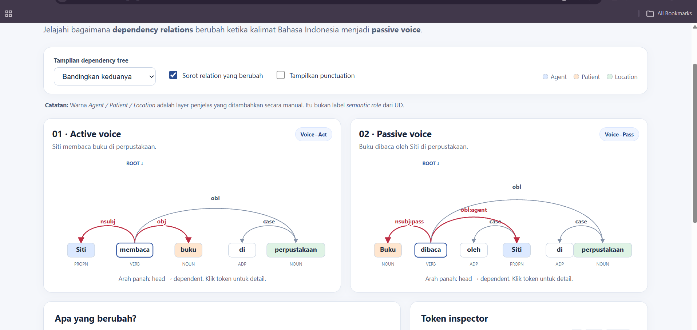
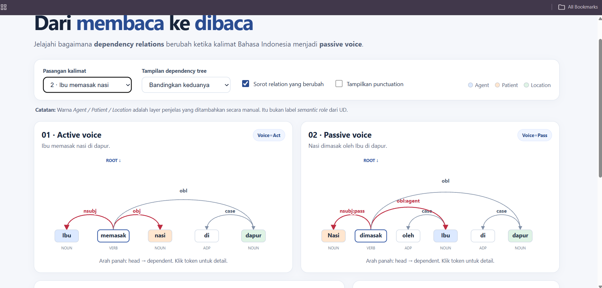

# Laporan Mini Assignment — Universal Dependencies Bahasa Indonesia

**Nama / Kelompok:** Karl Erich Sihombing
**Kelas:** NLP 
**Tanggal:** 28 Oktober 2026

## A. Ringkasan hasil

Pada *dependemcy tree visualization* membandingkan 2 tree dengan makna yang sama namun memiliki perbedaan pada pola kalimat dimana yang satu merupakan kalimat aktif dan kaimat pasif. Pada tree kita bisa melihat kata mana yang menjadi head dan kata mana yang menjadi dependent, hal itu juga diperjelas pada bagian token inspector yang juga menyediakan informasi suatu kata seperti yang mana head nya DEPREL dsb. Di dalamnya juga terdapat informasi mengenai sifat kata mana yang berubah antara aktif dan pasif seperti contohnya kata *Siti* merupakan *nsubj* pada aktif namun berubah menjadi *obl* pada pasif

## B. Perbandingan *active–passive voice*

| Semantic role (interpretasi manual) | Active: token + `DEPREL` | Passive: token + `DEPREL` | Apa yang berubah? |
|---|---|---|---|
| Agent | Siti -> nsubj | Siti -> obl:agent | Peran kata yang sebelumnya dari sebagai subyek pada kalimat aktif berubah fungsi menjadi oblique sebagai informasi tambahan |
| Patient | buku -> obj | buku -> nsubj:pass | fungsi kata yang sebelumnya merupakan objek yang "dijelaskan" kini menjadi subjek yang "menjelaskan" pada kalimat pasif |
| Location | perpustakaan -> obl | perpustakaan -> obl | Tidak ada perubahan |

## C. Jawaban analisis (200–300 kata total)

**C1.** Mengapa `buku` berubah dari `obj` menjadi `nsubj:pass`?

Universal Dependency mencatat fungsi gramatikal. Pada kalimat aktif, bukuadalah objek langsung dari membaca. Pada kalimat pasif, argumen yang dikenal tindakan naik menjadi subjek gramatikal dari dibaca. Meskipun secara makna tetap sama namun hanya posisi dalam kalimat saja yang berubah.

**C2.** Mengapa `Siti` berubah dari `nsubj` menjadi `obl:agent`?

Siti tetap sebagai pelaku membaca secara makna, namun pada pasif ia bukan lagi subjek dan menjadi argumen diluar kalimat inti sehingga berlabel obl:agent. Dengan demikian secara tata berubah namun secara makna tidak

**C3.** Mengapa `di` di “di perpustakaan” menjadi token `case`, tetapi `di-` pada “dibaca” tidak menjadi node sintaksis tersendiri?

kata di pada "di perpustakaan" adalah kata terpisah (ADP), sehingga menjadi node sendiri dengan relasi case terhadap perpustakaan yang menjadi head. Namun kata di pada dibaca adalah prefiks satu kata. Karena Universal Dependency berbasis lexicalism, dibaca tetap satu node dan informasi pasifnya dicatat di FEATS

**C4.** Bagaimana temuan Anda terhubung dengan minimal satu bagian paper (§2.1, §2.2, §2.5, §2.7)?

Yang paling relevan adalah §2.5. Preposisi tidak menjadi head frasa, melainkan case dari kata isi. Contohnya case(perpustakaan, di) dan case(Siti, oleh). Akibatnya Siti dan perpustakaan tetap menjadi head frasa nominalnya, sehingga obl:agent dan obl terhubung langsung ke verba dibaca. Ini membuat struktur lebih mudah dibandingkan antarbahasa, termasuk bahasa yang memakai akhiran kasus, bukan preposisi.

## D. Modifikasi kode

**Fitur yang ditambahkan:** 
memilih **pasangan kalimat**:
1. "Siti membaca buku di perpustakaan." / "Buku dibaca oleh Siti di perpustakaan."
2. "Ibu memasak nasi di dapur." / "Nasi dimasak oleh Ibu di dapur."

**File dan bagian yang diubah:** 
- `data/contoh_kalimat.conllu`: menambah dua kalimat baru dengan `sent_id` `aktif2` dan `pasif2`. Dua kalimat awal tidak diubah.
- `index.html`: menambah elemen `<select id="pair">` pada panel kontrol, dengan gaya yang sama dengan dropdown yang sudah ada.
- `app.js`:
  - Menambah konstanta `PAIRS` yang memetakan tiap pasangan ke `sent_id` kalimat aktif dan pasifnya.
  - Menambah `aktif2` dan `pasif2` pada `SEMANTIC_ROLES`.
  - Mengubah `render()` agar membaca pasangan terpilih.
  - Mengubah `renderComparison(pair)` agar tabel dibuat dari pasangan terpilih.
  - Membuat keterangan *Voice* dari token *root* (sebelumnya teks tetap).
  - Menambah `resetInspector()` agar inspector tidak menampilkan token dari kalimat sebelumnya.
  - Menambah pengecekan di `main()` bahwa semua `sent_id` yang dibutuhkan ada di fi

**Hasil pengujian:** 
- `python validate_conllu.py data/contoh_kalimat.conllu` meloloskan 4 kalimat (6, 7, 6, 7 *syntactic words*; masing-masing satu *root*).
- Di browser (`http://localhost:8000/`), pada pasangan 2 label yang muncul sama dengan pasangan 1: `Ibu`: `nsubj` → `obl:agent`, `nasi`: `obj` → `nsubj:pass`, `dapur`: `obl` pada kedua kalimat. Pada kedua pasangan, `oleh` dan `di` berlabel `case`.
- Tabel perbandingan dan keterangan *Voice* ikut berganti, dan opsi "Sorot relation yang berubah" serta "Tampilkan punctuation" tetap berfungsi pada kedua pasangan.

**Screenshot before/after:** 

Sebelum (hanya satu pasangan kalimat):

Sesudah (pasangan 2 dapat dipilih):

## E. Refleksi

Apa satu hal tentang Bahasa Indonesia atau UD yang baru Anda pahami setelah melihat visualisasi?

label panah dan peran makna adalah dua hal yang berbeda. Pada visualisasi, `Siti` (atau `Ibu`) tetap berwarna *agent* di kalimat aktif maupun pasif, tetapi labelnya berubah dari `nsubj` menjadi `obl:agent`. Artinya UD mencatat fungsi gramatikal dalam klausa, bukan siapa yang melakukan tindakan. Saya juga baru sadar bahwa `di` pada "di perpustakaan" menjadi node `case` sendiri, sedangkan `di-` pada "dibaca" tidak, karena UD menghubungkan kata utuh (lexicalism).

## F. Referensi

- de Marneffe et al. (2015 revision). [*Universal Dependencies: A cross-linguistic typology*](https://nlp.stanford.edu/~manning/papers/USD_LREC14_UD_revision.pdf).
- [Universal Dependencies — Indonesian-GSD](https://universaldependencies.org/treebanks/id_gsd/index.html).
- Dokumentasi UD v2 lain yang Anda gunakan:
  - [Format CoNLL-U](https://universaldependencies.org/format.html) — kolom `ID`, `FORM`, `HEAD`, `DEPREL`, `FEATS`.
  - [Daftar relasi UD v2](https://universaldependencies.org/u/dep/index.html) — `nsubj`, `obj`, `obl`, `case`.
  - [`nsubj:pass` (Indonesian)](https://universaldependencies.org/id/dep/nsubj-pass.html) — subjek nominal pada klausa pasif.
  - [`obl:agent` (Indonesian)](https://universaldependencies.org/id/dep/obl-agent.html) — pelaku pada klausa pasif.
  - [`case`](https://universaldependencies.org/u/dep/case.html) — penanda kasus/preposisi (`di`, `oleh`).
